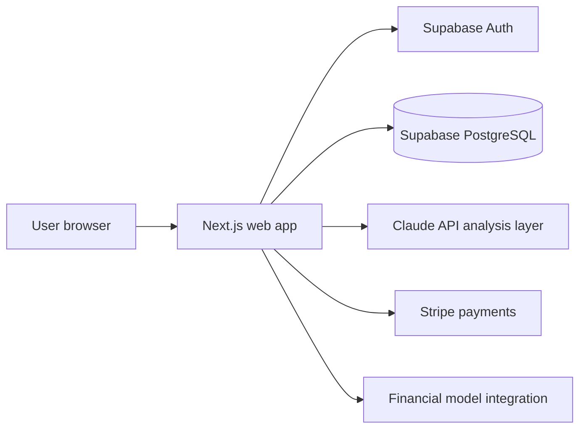

# CREUW.AI Platform

**AI-powered commercial real-estate SaaS**

     

> [!NOTE]
> **Source code is private by design.** This project was delivered for a client under confidentiality. Publishing the source, schemas or detailed integration logic would make the system easy to reverse-engineer, and in a fast-moving market that would put the client's business at risk. This repository is a case study only: what was built, how it is structured at a high level, and what I contributed.

## Overview

CREUW.AI is a SaaS platform for commercial real estate that pairs a modern web application with an AI analysis layer built on the Claude API. It was delivered in milestone-approved phases, with later phases extending the platform with financial-model integration.

## What was built

- Full-stack web application built with Next.js
- Authentication and data layer on Supabase (PostgreSQL)
- AI analysis features powered by the Claude API
- Payments through Stripe
- Phased delivery with client approval at every milestone
- Financial-model integration in the later phases

## Architecture (high level)

A simplified map of the main building blocks. Internal services, data models and integration details are intentionally left out.

## Tech stack

| Layer | Technologies |
|---|---|
| Frontend / app | Next.js, React |
| Backend and data | Supabase, PostgreSQL |
| AI | Claude API |
| Payments | Stripe |
| Hosting | Vercel |

## Engineering highlights

- AI is a first-class product feature, not a bolt-on
- Auth, data and payments sit on managed services to keep the attack surface small
- Milestone-based delivery so the client signs off on working software, not promises

## My role

Led architecture and end-to-end delivery: full-stack development, AI integration and client communication.

## Links

- Live product: https://creuw.ai

## What is in this repository

- This README with the project overview and architecture map
- No client source code, credentials, data or internal documentation

---

Built by **[Muhammad Kamran](https://github.com/raiskami)** at **[SvnStack](https://svnstack.com)**

[Website](https://svnstack.com) · [LinkedIn](https://www.linkedin.com/in/muhammad-kamran-391a50345) · [Upwork](https://www.upwork.com/freelancers/muhammadkamran128)

